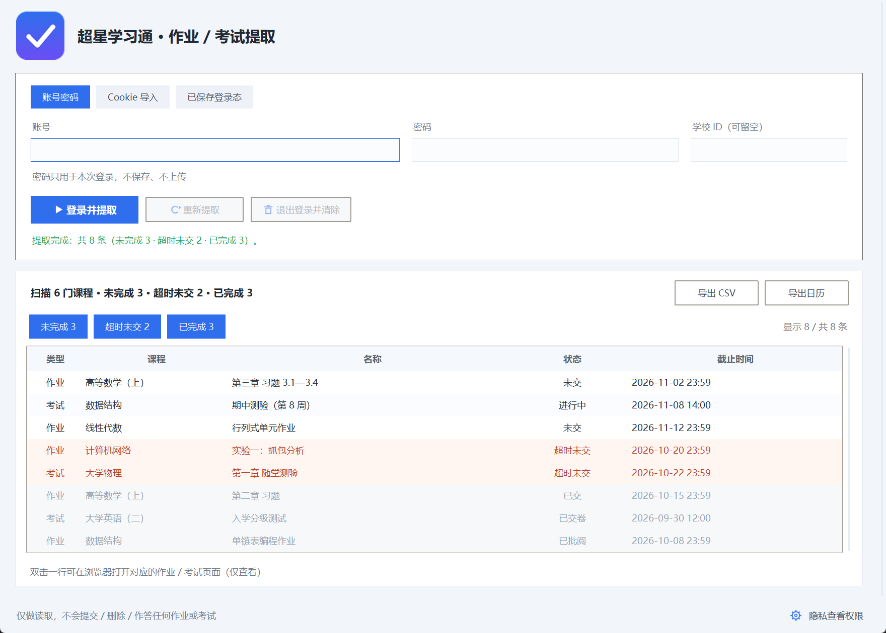

# 超星学习通 · 未完成作业 / 考试提取（Windows 桌面版）

[](../LICENSE)

> 这里是桌面版说明。安卓版见 [`../android/`](../android/)，两个版本总览见 [README](../README.md)。

一个 Windows 桌面小工具：登录学习通后，把**还没做的作业、还没考的试**一次性列出来，按「未完成 / 超时未交 / 已完成」分块显示，可以导出 CSV 或日历。

**只读**。不提交作业、不答题、不改动任何数据。



---

## 为什么会有这个工具

学习通的课程、作业、考试分散在不同页面，一门一门点进去看截止时间很费事，很容易漏。这个工具做的就是：一次扫描全部课程 → 合并作业和考试 → 按紧急程度排好 → 告诉你哪些快到期了。

同时它把「登录态」当成敏感数据对待：加密存储、只读使用、不写日志、不落原始页面。

---

## 功能

| 功能 | 说明 |
|---|---|
| 三种登录方式 | 账号密码直登 / 粘贴或导入 Cookie / 复用本机已保存的登录态 |
| 一次性扫全量 | 所有课程的作业 + 考试，自动翻页，结果合并去重 |
| 三块分组 | 未完成 / 超时未交 / 已完成，按紧急程度排序（紧急的在上） |
| 任意筛选 | 三个开关随意组合，至少保留一块，切换时整表重画不留空行 |
| 双击直达 | 双击任意一行，在浏览器打开对应的作业 / 考试页面（仅查看） |
| 导出 | CSV（含分类列）、ICS 日历（可导入 Outlook / 日历 / 手机） |
| 多分辨率适配 | 按 DPI 自动缩放，页面可滚动，窗口高度随内容收缩 |
| 新老界面兼容 | 同时支持学习通的新版（Vue / mooc-ans）和老版页面 |
| 首次运行声明 | 第一次打开时展示许可与免责声明，同意后才进入主界面（只弹一次） |

---

## 快速开始

1. 从 [Releases](../../releases) 下载 `超星作业提取-安装程序.exe`；
2. 双击运行，按向导走：同意许可 → 选择安装位置 → 安装（自动创建开始菜单快捷方式，可选桌面快捷方式）；
3. 从开始菜单启动程序，第一次会先显示许可与免责声明，同意后进入主界面；
4. 选择一种登录方式，点「登录并提取」；
5. 结果按三块列出来，点开关可以只看其中一块或两块。

**卸载**：Windows「设置 → 应用」里找到「超星作业提取」点卸载；也可以运行安装目录下的
`超星作业提取.exe --uninstall`。卸载会一并删除本机保存的登录状态。

> 不想装也可以：Releases 里另有免安装的 `超星作业提取.zip`，解压到有写权限的目录
> （桌面、D 盘某个文件夹，别放 `C:\Program Files`）直接双击 exe 即可。

### 三种登录方式

- **账号密码** —— 直接登录学习通。密码只在本次登录的内存里用，不保存、不上传，登录成功后输入框会被清空。
- **Cookie 导入** —— 从浏览器导出 Cookie 后粘贴，或点「选择 Cookie 文件…」导入 `.json` / `.txt`。
- **已保存登录态** —— 之前在这台电脑上登录过、`cookie/session.dat` 还在，就能直接「提取」，不用重新登录。

---

## 分块规则

每条任务在提取时就判定归属：

1. **已完成** —— 作业已交 / 考试已交卷。**优先判定**，哪怕截止时间已过也算完成；
2. **超时未交** —— 没做，且截止时间已经过去。没有具体时间但考试状态为「已结束」的也归这里；
3. **未完成** —— 还没到期。拿不到时间的一律当作待办（宁可提醒你别漏，也不误判成超时）。

表格排列顺序就是 **未完成 → 超时未交 → 已完成**。三块的视觉区分：

| 块 | 行底色 | 状态列 |
|---|---|---|
| 未完成 | 白色 / 淡蓝斑马纹 | 原状态（未交、进行中…） |
| 超时未交 | 淡红 | 超时未交 |
| 已完成 | 淡灰、灰字 | 已完成 / 已批阅 / 已交卷 |

---

## 隐私与安全设计

这一节是这个项目最花心思的地方，也是它和「直接抓包脚本」的区别。

### 1. Cookie 只加密保存，且只读使用

- 登录态写在 `cookie/session.dat`：**AES-256-CTR** 加密 + **HMAC-SHA256** 完整性校验，密钥用 **scrypt**（N=16384, r=8, p=1）派生自本机密钥；
- 程序其余部分拿到的是只读视图（`ReadOnlyCookies`），**禁止导出、禁止写回、禁止遍历外传**；
- 软件不写操作日志，不记录课程名、作业名、截止时间，也不保存任何原始网页快照。

### 2. 密钥常驻本机，不外传

- 加密密钥由**本机密钥**派生，只在内存与本地文件中流转，**不上传、不写日志、不随导出文件流出**；
- 密钥与这台电脑绑定：复制到别的电脑上解不开，换机或重装系统后需要**重新登录一次**；
- 想彻底作废：点界面上的「退出登录并清除」，本地加密文件会一并删除。

### 3. 加密实现没有第三方依赖

AES-128/192/256（CBC/CTR）、HMAC-SHA256、scrypt、PBKDF2 全部是**纯标准库实现**，没有引入 `pycryptodome` 之类的加密库。运行期第三方依赖只有 `requests` 和 `beautifulsoup4`（用于抓取和解析页面）。

---

## 运行时生成的文件

```
超星作业提取.exe
.eula.ok               ← 「已同意首次运行声明」的标记
cookie/session.dat     ← 加密的登录态
```

**想彻底清干净**：删掉 `cookie/` 与 `.eula.ok` 即可。也可以直接点界面上的「退出登录并清除」。

---

## 从源码运行

```bash
pip install requests beautifulsoup4
python app.py
```

系统要求：Windows 10 / 11，Python 3.9 及以上（源码运行时需要 Python 自带 tkinter）。

命令行也可以直接用（不带界面，输出到终端或 CSV）：

```bash
python chaoxing_extractor.py --cookies-file cookies.txt
python chaoxing_extractor.py --cookies "uf=xxx; _uid=123" --all --output out.csv
python app.py --selftest          # 内置自检，结果写在 selftest_log.txt，末尾应为 RESULT=OK
```

## 自己打包

双击 `build_installer.bat` 即可，它会自动完成 4 步：

1. 用 **MSYS2 的 mingw64 Python**（本机唯一带 tkinter 的解释器）创建 `.build-venv`；
2. 安装 `requests` / `beautifulsoup4` / `pyinstaller`（走清华镜像）；
3. PyInstaller 打包单文件主程序 `超星作业提取.exe`；
4. 把主程序内嵌进 `installer.py`，产出 `超星作业提取-安装程序.exe`。

安装程序（`installer.py`）是个 tkinter 向导：欢迎 → 许可协议 → 选择安装位置 → 进度 → 完成。
它会把主程序复制到目标目录、创建开始菜单（可选桌面）快捷方式，并写一条
`HKCU\...\Uninstall\ChaoxingHelper` 卸载项，所以「设置 → 应用」里能直接卸载。
支持静默安装：`超星作业提取-安装程序.exe --silent --dir "D:\Apps\超星作业提取"`。

`make_zip.py` 另外产出一个免安装的 zip（exe + 源码）。它是**白名单**打包，带隐私闸门 ——
一旦发现路径或文件名命中 `cookie/` / `*.dat` / `*.log` / `keys/` 之类，会**直接中止、不生成 zip**，
同时把被排除的文件打印出来。这样就不会不小心把自己的登录态发出去。

---

## 常见问题

**Q：换电脑 / 重装系统后，还能直接用已保存的登录态吗？**

不能。登录态与这台电脑绑定，换机或重装后解不开，用「账号密码登录」重新登录一次即可。

**Q：exe 被杀毒软件报毒？**

PyInstaller 单文件打包的常见误报（会自解压到临时目录、启动子进程）。加白名单即可，或者从源码运行。

**Q：提取结果为空？**

先在浏览器里确认学习通能正常打开课程列表，再点「重新提取」。如果是刚登录完，等几秒让会话生效。老版和新版页面都兼容，但仍可能遇到学校自定义模板，这种情况下只能改解析规则。

**Q：能自动交作业吗？**

不能，这个工具**只读**。它连「打开作业页面」都是交给系统浏览器，自己不发任何写请求。

---

## 免责声明

本项目仅用于个人学习辅助，帮助你掌握自己的作业与考试时间安排。使用时请遵守所在学校的规定与学习通的服务条款。作者不对使用本工具造成的任何后果负责。

**本项目仅供编程学习与技术交流**（例如了解网页结构、练习 Python 开发），不作为日常使用的工具。请在下载或获取后 24 小时内删除本项目及其全部副本（源码、安装包与可执行文件）；如果你需要长期管理自己的作业与考试时间，请直接使用学习通官方客户端或学校提供的渠道。

本项目与超星学习通及其所属机构没有任何关联，未获其授权或认可。继续保留或使用本项目，即视为你已自行评估相关风险，并同意自行承担由此产生的全部后果。

请勿将本项目用于自动化签到、刷课、代做、批量爬取他人数据等用途。

---

## 许可

本项目采用 [MIT 许可证](LICENSE)。你可以自由使用、修改和分发，保留版权声明即可。

许可证授予的是代码层面的使用权利，不构成对任何使用场景的认可 —— 具体使用仍需遵守学校规定与学习通服务条款（见上方免责声明）。
